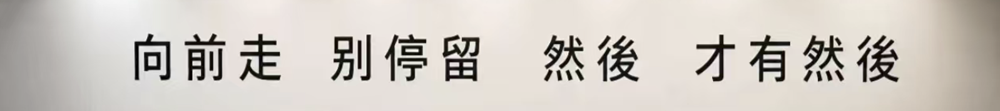

# 一则小记

今天是2026.11.16，上完了今天的课程，借着这个空闲时间来写一篇小记。

虽然说是小记，但不如直接点说是个人的日记呢。算了算了，日记就日记哈。文笔不好，当日记写也不错，权当记录吧。

开学时间好久了，马上三个月了。说说我的感受，大连很好，环境不错，景色不错，空气不错。唯一就是大连到了秋冬天风好大呀，每天早上去上课，都会被风吹成啥子，头发乱糟糟的。来到这里接近三个月，似乎也没逛过几处景点，可能也是自己比较懒。不过相较于去逛景点，我更喜欢去公园，坐在长椅上、石凳上，亦或是草坪上，又或者是随便一块干净的石头上，静静地坐在上面享受阳光、音乐和一个人，此时此刻似乎世界都是只剩下了自己，一种非常舒服的状态。

关于大连这边的景点很多，我去的不多。2026年3月份的时候，我和我爸去逛了一下大连国际雕塑公园、星海公园。来到大连，这真是我第一次看海（不怕被笑话）。2026年8月底，我和我爸妈来大连逛了一下七贤岭公园。9月份，应该是和组里去了海之韵公园。现在一看怎么都是逛的公园，之前没发现呢。

这里我回想了一下之前的时间的事情，

--------------------------------------------------------------分割线------------------------------------------------------------------------------------

这里我要吐槽一下上高中时候的自己。

我很疑惑我高中在干什么，似乎我也没学好文化知识，也没把游戏技术练得很6。好吧，也别纠结高中了。高中还是挺开心的，有很多同学朋友，可以一起吹水打闹，跟“老八”下课一块飞奔食堂，第一次跟着跑的时候，是真累的不行了，不过多跑几次，后面就能慢慢跟上了。高中也很遗憾吧，有很多事情没有把握住（~~此处省略吧~不讲不讲~~），太小孩子气了。现在想想，自己也不是聪明小孩，高考考的分都是属于高三一年补上来的，为啥之前不认真学习呢。

结束我高中的吐槽。

--------------------------------------------------------------分割线------------------------------------------------------------------------------------

之前似乎都没有出过省，很多事情都是上了大学之后才第一次去干。第一次进实验室接触CTF，第一次参加ISCC得奖，第一次参加蓝桥杯进总决赛（虽然是只有参与奖，不过也很开心，靠自己拿了个Python B组省一，还去淄博山理工看了一眼），第一次参加睿抗进入决赛来到武汉（武汉好多高校。武汉热干面也很好吃，主要是老师请吃的热干面，老师太好了！）。想想自己当时大一跟个啥子一样，啥都不知道，想想好像是光玩了。大二才加入的实验室，实验室这个大家庭，里面的所有人都很好，可以相互吹水，也可以相互交流讨论；真的学到了好多，虽然自己笨蛋一个，也学得很慢哈哈哈。

本科时光是很值得回味的，研究生生活感觉就多了很多烦恼。可能是在烦恼小论文、科研、成绩和以后的工作吧，感觉本科还是比较无忧无虑吧。本来会觉得，适应新环境要很久，不过还好吧。导师人很好，同门也很好，我这个i人也能融入。每周五组会开完，大家还会去一起吃饭，挺好的，不过我这个不喜欢动脑子的人就坐着等吃就好了。不过，感觉到现在还是有时候会焦虑。反正焦虑只会是一时的，做好自己的吧。

