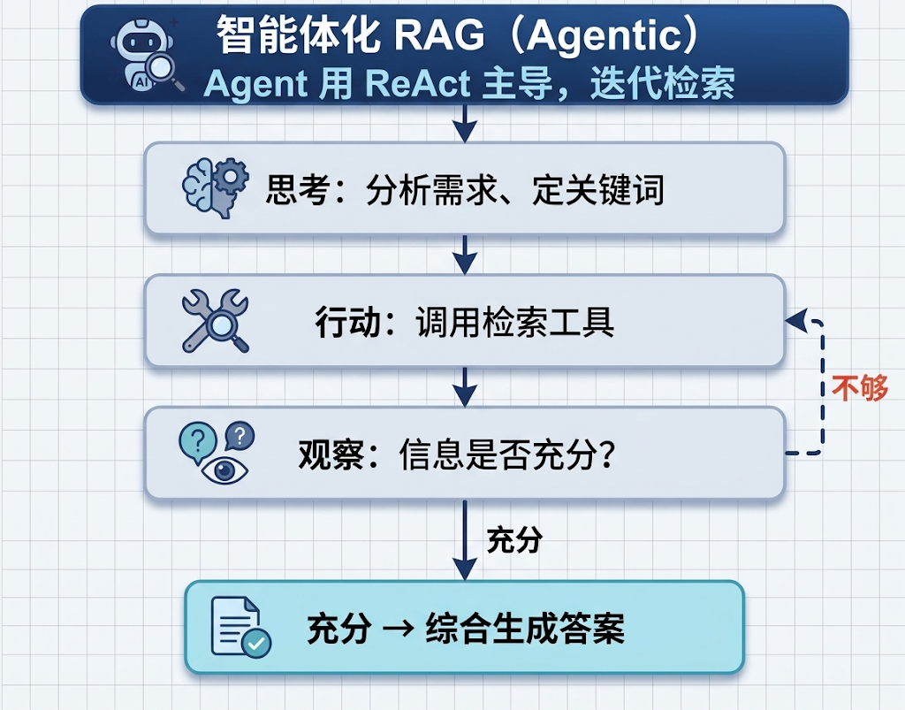
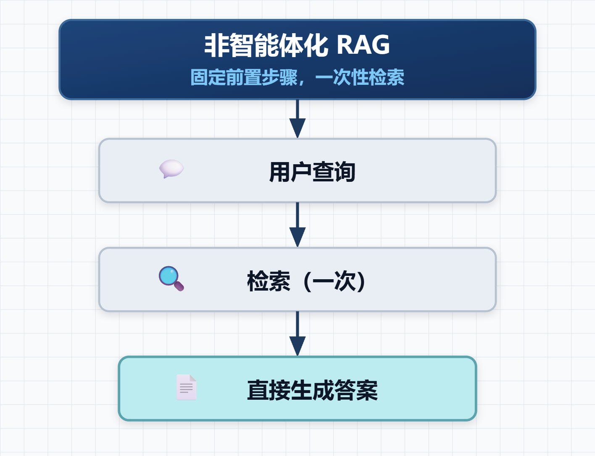

> 继前面所学的 `RAG` 之后的深入学习，所以对 `Agentic RAG` 进行了解
>
> 这一篇是对上一篇的衔接与续写

# 0x01 ~ 衔接上文

传统 `RAG` 即前面所学的**非智能体化（Non-Agentic）RAG**。

**Non-Agentic RAG** 流程通常是一个简单直接的单向数据流：用户的查询直接用于检索，检索结果直接注入模型上下文，模型直接生成最终答案。

# 0x02 ~ 为什么需要 Agentic RAG

`Non-Agentic RAG` 模式虽然相对高效，但其能力上限也很低。

本质上来说，其只是一个被动的 ”检索 - 生成“ 过程。`Non-Agentic RAG` 模式缺乏对问题进行深度理解、分解和迭代探索的能力。

> 1、缺乏深度理解（过度依赖字面匹配）：传统 RAG 只是机械地将用户的原话转为向量去检索，既不理解用户的真实意图，也不判断是否有必要检索。
>
> 2、缺乏问题分解能力（无法应对复杂与多跳问题）：当一个复杂问题包含多个子问题，或者需要“先查出 A，再根据 A 去查 B”时，单次检索往往顾此失彼。
>
> 3、缺乏迭代探索能力（”一锤子买卖“，没有纠错机制）：在传统 RAG 中，检索只发生一次。如果第一次召回的片段里没有答案，流程不会回头，只是继续往下走。

基于上述原因，必须将 `RAG` 从一个固定的数据处理流程，升级成由 `Agent` 主导的、动态的、迭代的探索过程。这也就是 `Agentic RAG` 的思想。

# 0x03 ~ 什么是 Agentic RAG

> **Agentic RAG（智能体检索增强生成）** 是将 **AI Agent（智能体）** 的自主规划、工具调用和反思能力引入 RAG 系统的技术架构。

定义总是枯燥乏味的。

简单来讲，`Agentic RAG` 就是将 `RAG` 的处理封装成了工具供 `Agent` 调用，由 `Agent` 自主判断选择何时使用。

# 0x04 ~ Agentic RAG 的流程

在面对复杂问题时，`Agent` 会首先 ”思考“ 分析核心需求，来自主决定使用什么**关键词**有效获取信息（**Thought**）；然后 `Agent` 进行 ”行动“ 调用封装好的工具（**Action**）；在 ”观察“ 到初步结果后不会立即生成答案，而是会判断信息是否充分能够得到最终的答案（如果不够则会进行下一轮循环，提炼更精确的查询再次搜索，还可能调用其他工具辅助，直到收集到充分信息能够得到最终答案）(**Observation**)。

`Agentic RAG` 即融入了 `ReAct` 模式，**Thought → Action → Observation**

这里再附上一张 `Non-Agentic RAG` 的概况流程图供与 `Agentic RAG` 参考对比

