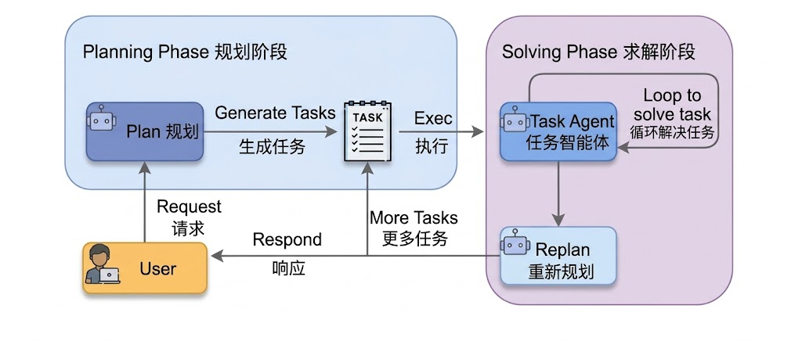

# 0x01 ~ 引例

在开始这篇博客之前，现在有一个简单的数学问题

> 一个水果店周一卖出 15 个苹果，周二销量是周一的两倍，周三比周二少 5 个，三天总共卖出多少？


按照人的思维，我们在解决这个问题时，一般会拆成三步：

1、先算周二的销量。 	Tues = Mon x 2

2、再算周三的销量。	 Wed = Tues - 5

3、最后算三天总销量。     Total = Mon + Tues + Wed


# 0x02 ~ 什么是 Plan-and-Solve

> Plan-and-Solve 将任务处理分成两个阶段：
>
> - 规划阶段：先分解问题并指定分步骤计划
> - 执行阶段：严格按照计划逐步求解

简单来说就是，“谋定后动，三思而行”。先做规划，再按照规划去执行。

下面是 Plan-and-Solve 的工作流：




# 0x03 ~ COT、ReAct、Plan-and-Solve

| 模式           | 核心方式           | 优点               | 局限                                 | 适合场景                     |
| :------------- | :----------------- | :----------------- | :----------------------------------- | :--------------------------- |
| CoT            | 连续推理           | 简单直接           | 多步复杂问题容易偏离                 | 中等复杂度推理               |
| ReAct          | 推理 + 观察 + 调整 | 动态适应环境       | 依赖工具/观察，路径可能不稳定        | 工具调用、交互式任务         |
| Plan-and-Solve | 先规划再执行       | 结构清晰、步骤可控 | 规划错误会传播，执行中不一定会重规划 | 多步数学、报告、代码结构设计 |

> ReAct 就是走一步看一步，根据 Observation 进行一步步推理，然后调整自己的工作方向
>
> Plan-and-Solve 则是在动工之前进行规划设计，给出一个方案蓝图，然后按照蓝图来进行工作
>
> Plan-and-Solve 是为了解决 COT 在处理多步骤、复杂问题时 “偏离轨道” 的问题
>
> Plan-and-Solve 适用的问题：
>
> - 多步数学应用题：先列出计算步骤，再逐一求解
> - 需要整合多个信息源的报告撰写：需要先规划好报告结构，再逐一填充内容
> - 代码任务：需要先构思好函数、类和模块的结构，再逐一实现
>
>
> Plan-and-Solve 的执行逻辑：每一步结果作为下一步输入


# 0x04 ~ 引例数学问题的解决

经过上面的介绍，我们已经大致了解了 Plan-and-Solve 是什么东东了。

上述引例，正常人们可以很快的进行求解，得到正确答案。运用所学的 Plan-and-Solve ，就是对此问题进行 “规划 + 执行”

规划阶段：

```python
[
    "计算周二苹果销量",
    "计算周三苹果销量",
    "计算三天总销量"
]
```

执行阶段：

```text
步骤1：周二销量 = 15 * 2 = 30
步骤2：周三销量 = 30 - 5 = 25
步骤3：总销量 = 15 + 30 + 25 = 70
```

> 这个执行阶段清晰反映出了 Plan-and-Solve 的执行逻辑，如 0x03 引用块中所言。


# 0x05 ~ 代码实现

代码实现主要分为三个类：

- `Planner`: 根据问题生成计划列表
- `Executor`: 按计划逐步执行，维护 history
- `PlanAndSolveAgent`: 串联规划和执行


```python
# 导入包
import ast
import os
from dotenv import load_dotenv
from openai import OpenAI
```


```python
# 从我当前目录下的 .env 文件中加载，model、api_key、base_url
# 我此处用的是硅基流动的中转站
model = os.getenv("model")
api_key = os.getenv("api_key")
base_url = os.getenv("base_url")
```


```python
# 创建一个 OpenAI 客户端实例，后面所有调用大模型的请求都通过这个 client 发出 
client = OpenAI(
    api_key=api_key,
    base_url=base_url
)
```


```python
# 规划阶段的提示词
PLANNER_PROMPT_TEMPLATE = """
                            你是⼀个顶级的AI规划专家。你的任务是将⽤户提出的复杂问题分解成⼀个由多个简单步骤组成的⾏动计划。
                            请确保计划中的每个步骤都是⼀个独⽴的、可执⾏的⼦任务，并且严格按照逻辑顺序排列。你的输出必须是⼀个Python列表，其中每个元素都是⼀个描述⼦任务的字符串。
                            问题: {question}
                            请严格按照以下格式输出你的计划,```python与```作为前后缀是必要的:
                            ```python
                            ["步骤1", "步骤2", "步骤3", ...]
                            ```
                          """
```


```python
# 规划阶段
class Planner:
    def __init__(self, client):
        self.client = client

    def plan(self, question: str) -> list[str]:
        '''根据用户问题生成一个行动计划'''
        prompt = PLANNER_PROMPT_TEMPLATE.format(question=question)

        messages = [{"role": "user","content":prompt}]

        print("--- 正在生成计划 ---")

        # 获取模型的返回
        response = self.client.chat.completions.create(messages=messages, model=model, stream=False)
        
        # 获取模型返回中的完整的计划
        response_text = response.choices[0].message.content

        print(f"计划已生成:\n{response_text}")

        # 解析 LLM 输出的列表字符串
        try:
            
            # 得到分步骤的列表，例如 ["步骤1", "步骤2", "步骤3", ...]
            plan_str = response_text.split("```python")[1].split("```")[0].strip()
            
			# 把字符串解析成 Python 字面量对象,不会执行函数调用或任意代码
            plan = ast.literal_eval(plan_str)
            
            # 如果 plan 是列表类型则返回，否则返回空列表
            return plan if isinstance(plan, list) else []
       
    	# 捕获异常
        except (ValueError, SyntaxError, IndexError) as e:
            print(f"解析计划时出错：{e}")
            print(f"原始响应：{response_text}")
            return []
        except Exception as e:
            print(f"解析计划时发生未知错误：{e}")
            return []
```


```python
# 执行阶段的提示词
EXECUTOR_PROMPT_TEMPLATE = """
                            你是⼀位顶级的AI执⾏专家。你的任务是严格按照给定的计划，⼀步步地解决问题。你将收到原始问题、完整的计划、以及到⽬前为⽌已经完成的步骤和结果。
                            请你专注于解决“当前步骤”，并仅输出该步骤的最终答案，不要输出任何额外的解释或对话。
                            # 原始问题:
                            {question}
                            # 完整计划:
                            {plan}
                            # 历史步骤与结果:
                            {history}
                            # 当前步骤:
                            {current_step}
                            请仅输出针对“当前步骤”的回答:
                           """
```


```python
# 执行阶段
class Executor:
    def __init__(self, client):
        self.client = client

    def execute(self, question: str, plan: list[str]) -> str:
        """根据计划，逐步执行并解决问题"""
   
        history = ""
        
        print(f"\n --- 正在执行计划 ---")
		
        # 遍历计划，按计划一步步执行
        for i, step in enumerate(plan):
            print(f"\n -> 正在执行步骤 {i+1}/{len(plan)}: {step}")
			
            # 把 question、plan、history、current_step 替换进执行阶段的提示词中，替换进 {question}、{plan}、{history}、{current_step}
            prompt = EXECUTOR_PROMPT_TEMPLATE.format(
                question=question,
                plan=plan,
                history=history if history else "无",
                current_step=step
            )

            messages = [{"role": "user", "content": prompt}]
			
            # 获取模型的返回
            response = self.client.chat.completions.create(messages=messages, model=model, stream=False)
            # 获取模型返回的内容，即每一步骤的执行结果
            response_text = response.choices[0].message.content

            # 更新历史记录，为下一步做准备
            history += f"步骤 {i+1}: {step}\n结果: {response_text}\n\n"

            print(f"步骤 {i+1} 已完成, 结果: {response_text}")
		
        # 计划执行完成，最终的答案
        final_answer = response_text
        return final_answer
```


```python
# 串联规划和执行
class PlanAndSolveAgent:
    def __init__(self, client):
        self.client = client
        self.planner = Planner(self.client)
        self.executor = Executor(self.client)

    def run(self, question: str):
        """运行智能体的完整流程：先规划，后执行"""
        print(f"\n --- 开始处理问题 ---\n 问题：{question}")
		
        # 获取计划
        plan = self.planner.plan(question)

        # 检查计划是否成功生成
        if not plan:
            print("\n--- 任务终止 --- \n无法生成有效的行动计划")
            return
		
        # 获取执行阶段最后的答案
        final_answer = self.executor.execute(question, plan)

        print(f"\n --- 任务完成 ---\n 最终答案：{final_answer}")
```


```python
# 代码执行
if __name__ == "__main__":
    user_question = input("请输入您的问题: ")
    agent = PlanAndSolveAgent(client)
    agent.run(user_question)
```


以 **0x01** 的引例问题，作为此处代码执行输入的问题。这里的计划是分为了四个步骤，和前面咱们叙述的三个步骤不一样，不过重要的是思想。

````cmd
请输入您的问题: 一个水果店周一卖出 15 个苹果，周二销量是周一的两倍，周三比周二少 5 个，三天总共卖出多少？

 --- 开始处理问题 ---
 问题：一个水果店周一卖出 15 个苹果，周二销量是周一的两倍，周三比周二少 5 个，三天总共卖出多少？
--- 正在生成计划 ---
计划已生成:


```python
["确认周一卖出的苹果数量为 15 个", "计算周二卖出的苹果数量，即周一数量的两倍", "计算周三卖出的苹果数量，即周二数量减去 5 个", "计算三天总销量，将周一、周二和周三的数量相加"]
```

 --- 正在执行计划 ---

 -> 正在执行步骤 1/4: 确认周一卖出的苹果数量为 15 个
步骤 1 已完成, 结果: 

周一卖出的苹果数量为 15 个

 -> 正在执行步骤 2/4: 计算周二卖出的苹果数量，即周一数量的两倍
步骤 2 已完成, 结果: 

周二卖出的苹果数量为 30 个

 -> 正在执行步骤 3/4: 计算周三卖出的苹果数量，即周二数量减去 5 个
步骤 3 已完成, 结果: 

周三卖出的苹果数量为 25 个

 -> 正在执行步骤 4/4: 计算三天总销量，将周一、周二和周三的数量相加
步骤 4 已完成, 结果: 

三天总共卖出的苹果数量为 70 个

 --- 任务完成 ---
 最终答案：

三天总共卖出的苹果数量为 70 个

````


# 0x06 ~ 结语

```text
愿作东北风，吹我入君怀。
															- 《宋书》
```

